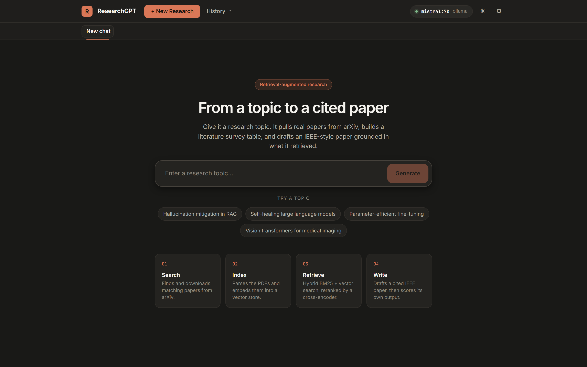
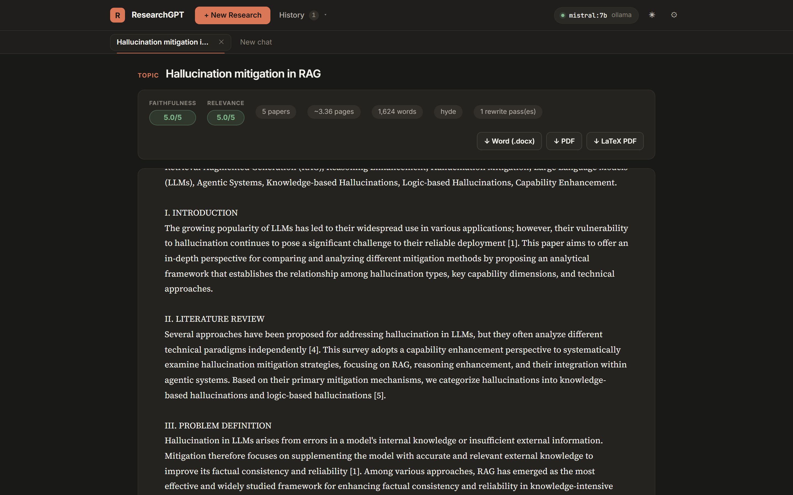
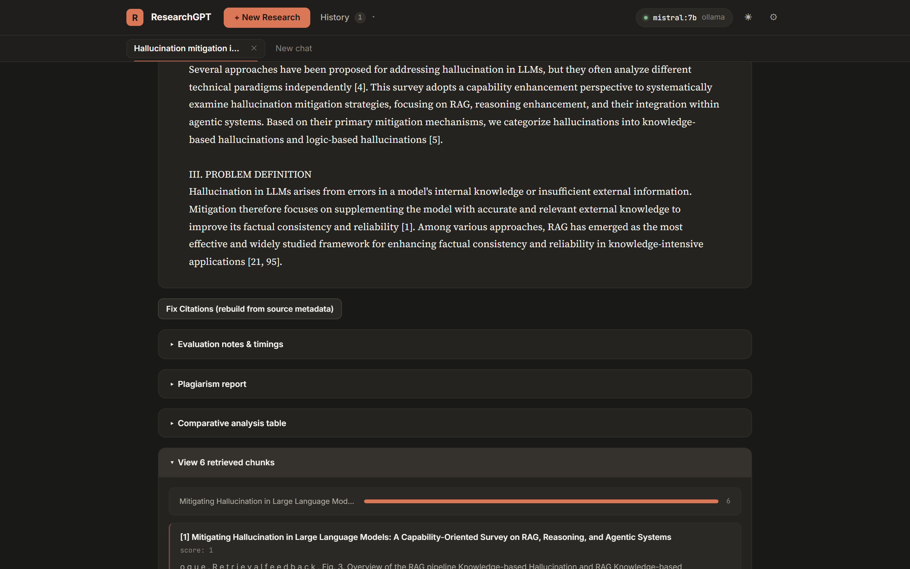
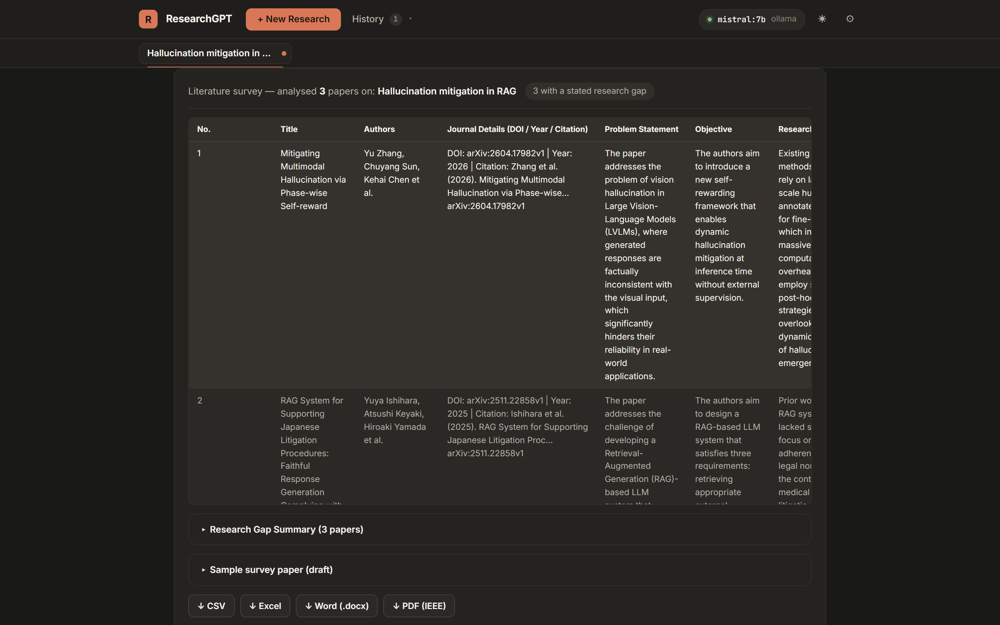
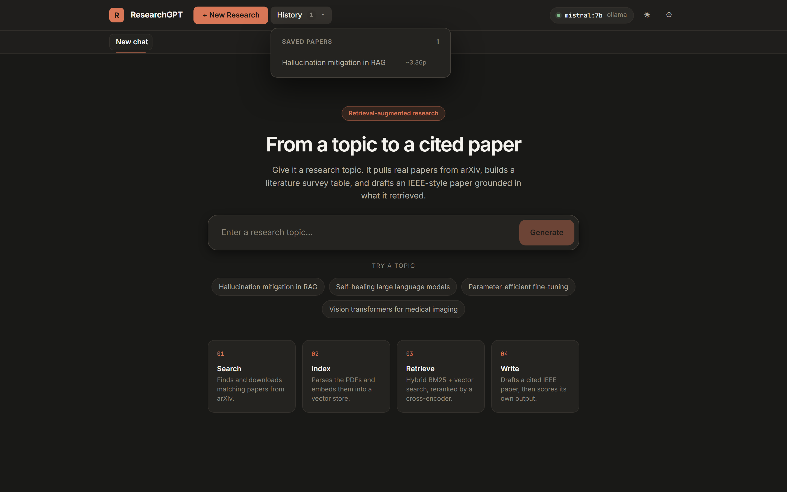
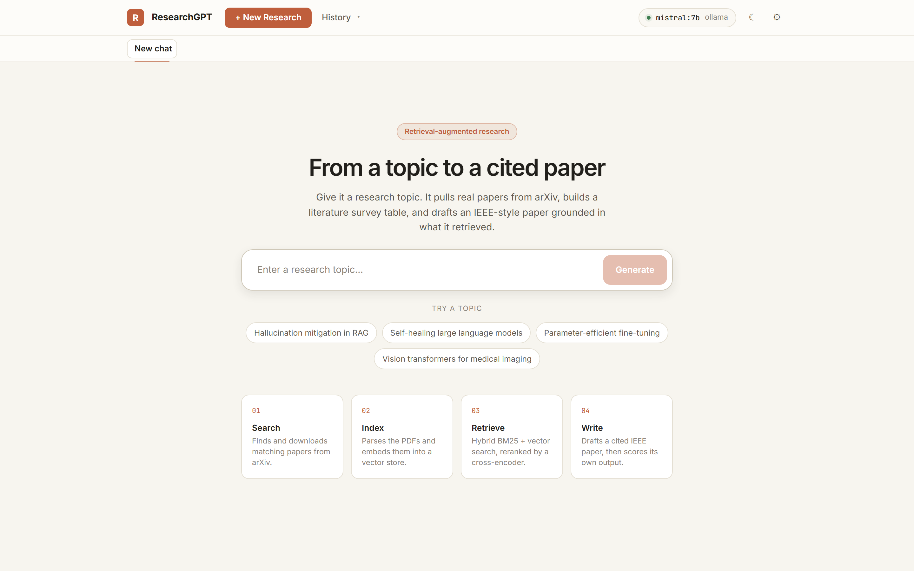

# ResearchGPT

**A retrieval-augmented research assistant that turns a topic into a literature survey and a cited, IEEE-style paper.**

ResearchGPT searches arXiv for relevant work, indexes the full text of each paper, retrieves the passages that matter, and drafts a structured paper grounded in what it found — then scores its own output for faithfulness and relevance. It runs entirely on your machine against a local [Ollama](https://ollama.com) model; no API key and no data leaving the host.

<p>
  
  
  
  
</p>



---

## Table of contents

- [Overview](#overview)
- [Capabilities](#capabilities)
- [Interface](#interface)
- [Architecture](#architecture)
- [Requirements](#requirements)
- [Installation](#installation)
- [Running the application](#running-the-application)
- [Configuration](#configuration)
- [Command-line interface](#command-line-interface)
- [HTTP API](#http-api)
- [Project structure](#project-structure)
- [Testing](#testing)
- [Troubleshooting](#troubleshooting)
- [How it works](#how-it-works)

---

## Overview

Writing a literature review means finding the relevant papers, reading them, extracting what each one contributes, and synthesising the result into prose that cites its sources. ResearchGPT automates the mechanical parts of that loop while keeping the output traceable: every generated claim is produced from retrieved passages that remain inspectable in the interface.

Given a topic, the system will:

1. Search arXiv and download the most relevant papers.
2. Parse, chunk and embed them into a local vector store.
3. Retrieve the passages most relevant to the topic using hybrid search with cross-encoder reranking.
4. Draft an IEEE-structured paper from those passages.
5. Evaluate the draft for faithfulness, relevance, lexical overlap and source similarity.
6. Export the result as PDF, LaTeX PDF, Word, Excel or CSV.

---

## Capabilities

### Retrieval

| Capability | Description |
|---|---|
| **Hybrid search** | BM25 lexical matching blended with dense vector similarity; the mix is tunable per strategy. |
| **HyDE** | Generates a hypothetical abstract for the query and embeds *that*, improving recall for short questions against long technical text. |
| **Sub-question decomposition** | Splits comparative queries ("compare X and Y") into independent retrievals, then synthesises across them. |
| **Cross-encoder reranking** | Rescores the shortlist by reading query and passage together, rather than comparing embeddings. |

### Generation and review

| Capability | Description |
|---|---|
| **Grounded drafting** | Produces IEEE-sectioned prose constrained to the retrieved context. |
| **Citation repair** | Rebuilds citations from stored source metadata when the model cites loosely. |
| **Originality pass** | Rewrites passages that overlap their sources too closely, re-measuring after each attempt. |
| **Iterative refinement** | Applies free-text instructions ("expand the limitations section") to an existing draft. |
| **Self-evaluation** | Scores faithfulness and relevance 1–5 with written reasoning, plus ROUGE-L and n-gram similarity. |

### Interface

A React single-page application with a horizontal command bar, parallel research sessions as tabs, live job progress, a saved-paper history, and light and dark themes. A status indicator reports whether the backend and the configured model are reachable before a long job is started.

A legacy Streamlit interface is retained as `ui.py` for reference.

---

## Interface

### Generated paper

Self-evaluation scores, source and length statistics, and one-click export to
Word, PDF or LaTeX PDF, above the draft itself.



### Provenance

Every draft keeps the passages it was written from. The contribution bar shows
how many retrieved chunks came from each paper — a draft drawing on a single
source is visible immediately, before you read a word of it.



### Literature survey

Every retrieved paper reduced to a twelve-column table — problem, objective,
research gap, methodology, results, limitations and future scope — exportable to
CSV, Excel, Word or a formatted IEEE PDF.



### Settings and history

Author details, survey size, retrieval strategy and top-k are adjustable per run.
Completed papers are saved and reopened from the History menu in the top bar.

<table>
  <tr>
    <td width="50%"></td>
    <td width="50%"></td>
  </tr>
</table>

### Light theme



> Screenshots are regenerated with `node scripts/capture-screenshots.mjs` while both
> processes are running.

---

## Architecture

```
                          ┌──────────────────────────┐
   Research topic ───────▶│  Ingestion               │  arXiv API → PDF download
                          └────────────┬─────────────┘
                                       ▼
                          ┌──────────────────────────┐
                          │  Processing              │  PyMuPDF parse → chunk
                          └────────────┬─────────────┘
                                       ▼
                          ┌──────────────────────────┐
                          │  Embedding               │  BGE embeddings → ChromaDB
                          └────────────┬─────────────┘
                                       ▼
                          ┌──────────────────────────┐
                          │  Retrieval               │  BM25 + vector → rerank
                          └────────────┬─────────────┘
                                       ▼
                          ┌──────────────────────────┐
                          │  Generation              │  Ollama / OpenAI-compatible
                          └────────────┬─────────────┘
                                       ▼
                          ┌──────────────────────────┐
                          │  Evaluation              │  G-Eval, ROUGE-L, similarity
                          └────────────┬─────────────┘
                                       ▼
                             PDF · LaTeX · DOCX · XLSX · CSV
```

The React client talks to a FastAPI backend. Long-running pipeline calls are dispatched to background threads and surfaced through a polled job API, so the interface stays responsive during multi-minute generations.

---

## Requirements

| Component | Version | Required |
|---|---|---|
| Python | 3.10 or later (developed on 3.13) | Yes |
| Node.js | 18 or later | Yes, for the web interface |
| [Ollama](https://ollama.com) | any recent release | Yes, when using the default local provider |
| `pdflatex` | TeX Live or MiKTeX | Optional — only for the LaTeX PDF export |

Roughly 6 GB of free memory is recommended: the quantised 7B model occupies about 4.4 GB, with the remainder going to the embedding and reranking models.

---

## Installation

**1. Install Python dependencies**

```bash
pip install -r requirements.txt
```

**2. Install frontend dependencies**

```bash
npm --prefix frontend install
```

**3. Pull the language model**

```bash
ollama pull mistral:7b
```

Configuration is read from `.env` in the project root, which ships preconfigured for a local Ollama setup. Use `.env.example` as a reference when changing providers.

---

## Running the application

The application consists of two processes.

**Backend** — http://127.0.0.1:8001

```bash
python -m uvicorn api.main:app --port 8001
```

**Frontend** — http://localhost:5173

```bash
npm --prefix frontend run dev
```

On Windows, `start.ps1` performs a preflight check against Ollama and launches both processes:

```powershell
.\start.ps1
```

Confirm the backend independently at any time:

```bash
curl http://127.0.0.1:8001/api/health
```

A healthy response reports `"status": "ok"` and the model currently being served.

---

## Configuration

All settings are resolved in `config/config.py` from environment variables, which are loaded from `.env`. Every setting has a working default, so only overrides need to be declared.

### Language model

| Variable | Default | Description |
|---|---|---|
| `RAG_LLM_PROVIDER` | `ollama` | `ollama` for local inference, `openai` for an OpenAI-compatible endpoint. |
| `RAG_OLLAMA_BASE_URL` | `http://localhost:11434` | Address of the Ollama daemon. |
| `RAG_OLLAMA_MODEL` | `mistral:7b` | Must correspond to an entry in `ollama list`. |
| `RAG_OLLAMA_NUM_CTX` | `16384` | Context window the model is loaded with. See the note below. |
| `RAG_OLLAMA_KEEP_ALIVE` | `30m` | How long the model stays resident between requests. |
| `RAG_OLLAMA_TIMEOUT` | `900` | Per-request timeout in seconds. |
| `RAG_LLM_MAX_TOKENS` | `4096` | Maximum tokens generated per call. |
| `RAG_LLM_TEMPERATURE` | `0.2` | Sampling temperature. |

> **Context window.** Ollama loads models with a 4096-token window by default. The prompts this pipeline assembles contain the retrieved passages and routinely exceed that, so the default would cause the model to be given a silently truncated prompt — producing text that ignores most of its sources. `RAG_OLLAMA_NUM_CTX` must therefore remain comfortably above the prompt size. Mistral 7B supports up to 32768; reduce to `8192` on memory-constrained hosts.

To use a hosted OpenAI-compatible endpoint instead:

```ini
RAG_LLM_PROVIDER=openai
CEREBRAS_API_KEY=your-key
RAG_OPENAI_BASE_URL=https://api.cerebras.ai/v1
RAG_OPENAI_MODEL=gpt-oss-120b
```

### Retrieval and pipeline

| Variable | Default | Description |
|---|---|---|
| `RAG_TOP_K` | `5` | Passages retained after reranking. |
| `RAG_MAX_PAPERS` | `5` | Papers downloaded per topic. |
| `RAG_SURVEY_DEFAULT_PAPERS` | `10` | Papers included in the survey table. |
| `RAG_CHUNK_SIZE` | `1000` | Characters per chunk. |
| `RAG_CHUNK_OVERLAP` | `350` | Overlap between consecutive chunks. |
| `RAG_EMBEDDING_MODEL` | `BAAI/bge-base-en-v1.5` | Sentence-transformer used for embeddings. |
| `RAG_CROSS_ENCODER_MODEL` | `cross-encoder/ms-marco-MiniLM-L-12-v2` | Reranking model. |
| `RAG_BM25_ALPHA` | `0.5` | Lexical/dense blend: `0` is pure BM25, `1` pure vector. |
| `RAG_MAX_CHUNKS_PER_SOURCE` | `3` | Cap on passages taken from any one paper. Prevents a single well-matching paper from supplying the entire context. |
| `RAG_TARGET_SIMILARITY_PCT` | `25` | Similarity to sources the originality pass aims for. |
| `RAG_MAX_REWRITE_PASSES` | `2` | Originality rewrites attempted while similarity stays above target. |

### Server

| Variable | Default | Description |
|---|---|---|
| `RAG_API_HOST` | `127.0.0.1` | Backend bind address. |
| `RAG_API_PORT` | `8001` | Backend port. |
| `RAG_CORS_ORIGINS` | Vite dev and preview origins | Comma-separated allowed origins; `*` permits any. |
| `RAG_JOB_RETENTION_SECONDS` | `7200` | How long finished jobs are retained in memory. |
| `RAG_ARCHIVE_ENABLED` | `true` | Write a Markdown record of each completed paper. |
| `RAG_ARCHIVE_DIR` | `docs/runs` | Where those records are written. |
| `RAG_LOG_LEVEL` | `INFO` | Logging verbosity. |

The frontend resolves its backend address from `VITE_API_URL`, declared in `frontend/.env` for production builds and `frontend/.env.development` for the dev server.

---

## Command-line interface

The full pipeline is available without the web interface:

```bash
python main.py run_all --query "Self-Healing Large Language Models"
```

| Command | Arguments | Description |
|---|---|---|
| `run_all` | `--query`, `--max` | Ingest, index, generate and evaluate in one pass. |
| `ingest` | `--query`, `--max` | Search arXiv and download PDFs. |
| `index` | — | Parse downloaded PDFs and rebuild the vector index. |
| `retrieve` | `--query`, `--k`, `--strategy` | Inspect retrieval: HyDE output, candidates and rerank scores. |
| `generate` | `--topic` | Generate a paper from the current index. |
| `evaluate` | `--query` | Run the evaluation metrics against a generated paper. |

Used programmatically:

```python
from src.pipeline.ui_pipeline import run_rag_for_ui_pipeline

result = run_rag_for_ui_pipeline(
    topic="Finetuning methods for large language models",
    retrieval_strategy="hyde",
    include_evaluation=True,
    fast_mode=True,
)

print(result["paper_text"])
print(result["faithfulness"], result["relevance"])
```

---

## HTTP API

| Method | Endpoint | Description |
|---|---|---|
| `GET` | `/api/health` | Provider readiness, active model and effective settings. |
| `POST` | `/api/generate` | Start a paper generation job. Returns a `job_id`. |
| `POST` | `/api/survey` | Start a literature survey job. Returns a `job_id`. |
| `POST` | `/api/refine` | Apply a refinement instruction to an existing draft. |
| `GET` | `/api/jobs/{job_id}` | Job status, progress events and result. |
| `GET` | `/api/history` | List saved papers. |
| `GET` · `DELETE` | `/api/history/{fname}` | Load or delete a saved paper. |
| `POST` | `/api/history/save` | Persist a result. |
| `POST` | `/api/fix-citations` | Rebuild citations from source metadata. |
| `POST` | `/api/export/pdf` · `/docx` | Export the paper. |
| `POST` | `/api/export/survey-docx` · `/survey-xlsx` · `/analysis-xlsx` | Export tabular output. |
| `GET` | `/api/download` | Retrieve a previously generated file. |

Interactive documentation is served at `http://127.0.0.1:8001/docs`.

---

## Archived runs

Every completed paper is written to [`docs/runs/`](docs/runs/) as the run finishes —
the draft itself alongside the scores, timings and the sources it was built from.
Unlike `data/`, which is a local cache, this archive is committed, so the record of
what the pipeline has produced lives with the repository.

The record is written as soon as a draft exists and rewritten once evaluation
completes, so a run that fails late still leaves its paper behind. E-mail addresses
are redacted on the way in: a generated title page is assembled by the model and can
repeat an address belonging to a real author of a source paper.

Set `RAG_ARCHIVE_ENABLED=false` to turn this off.

---

## Project structure

```text
ResearchGPT/
├── .env                      Active configuration
├── .env.example              Reference configuration
├── main.py                   Command-line entry point
├── ui.py                     Legacy Streamlit interface
├── start.ps1                 Windows launcher
├── requirements.txt
│
├── api/
│   ├── main.py               Routes, health, export endpoints
│   ├── jobs.py               Background job runner
│   └── schemas.py            Request models
│
├── config/
│   └── config.py             Centralised settings
│
├── src/
│   ├── ingestion/            arXiv search and download
│   ├── processing/           PDF parsing and chunking
│   ├── embedding/            ChromaDB vector store
│   ├── retrieval/            Hybrid search, HyDE, reranking
│   ├── generation/           LLM transport and prompt assembly
│   ├── evaluation/           G-Eval, ROUGE-L, similarity analysis
│   ├── analysis/             Survey table extraction
│   ├── output_pdf/           PDF, LaTeX and DOCX writers
│   ├── history/              Result persistence
│   └── pipeline/             End-to-end orchestration
│
├── frontend/
│   └── src/
│       ├── App.tsx           Application shell and job polling
│       ├── api.ts            Typed backend client
│       ├── components/       Menus, status, progress, landing
│       ├── index.css         Design tokens
│       └── App.css           Component styles
│
├── tests/                    Playwright end-to-end suites
├── scripts/                  Documentation generators
├── docs/                     Extended documentation and paper source
│
├── data/                     Papers, vector store, history (generated)
├── output/                   Generated papers (generated)
└── logs/                     Rotating application log (generated)
```

### Notable modules

- **`src/generation/llm_client.py`** is the sole point of contact with a language model. It implements both providers, retry and timeout handling, and the Ollama context and residency options, and exposes `LLMClient.health()`, which backs the health endpoint.
- **`src/generation/generator.py`** assembles prompts and post-processes model output. It re-exports `LLMClient` for backwards compatibility.
- **`api/jobs.py`** executes pipeline calls on daemon threads and records progress events for the client to poll. Completed jobs are evicted after `RAG_JOB_RETENTION_SECONDS`.

---

## Testing

The frontend suite runs against a mocked backend and requires neither a model nor network access:

```bash
npx playwright test --config=playwright.react.config.ts
```

Twenty-five end-to-end tests cover the empty state, settings persistence, the survey and generation flows, backend failure handling, export downloads, refinement, and session and history management.

A separate configuration targets the legacy Streamlit interface:

```bash
npx playwright test --config=playwright.config.ts
```

---

## Troubleshooting

| Symptom | Resolution |
|---|---|
| Status indicator reads **API offline** | The backend is not running. Start Uvicorn as described above. |
| Status indicator is red | Hover for detail. Typically the Ollama daemon is stopped (`ollama serve`) or the model has not been pulled (`ollama pull mistral:7b`). |
| Generation is slow | Expected for a 7B model without GPU acceleration. Reduce `RAG_SURVEY_DEFAULT_PAPERS`, `RAG_TOP_K` or `RAG_OLLAMA_NUM_CTX`. |
| Output disregards the retrieved sources | `RAG_OLLAMA_NUM_CTX` is too small for the assembled prompt. Increase it. |
| Model fails to load | Insufficient memory. Reduce `RAG_OLLAMA_NUM_CTX` to `8192` or select a smaller model. |
| LaTeX PDF export fails | `pdflatex` is not on the path. The standard PDF export has no such dependency. |
| Word or Excel export fails | Reinstall dependencies; `python-docx` and `openpyxl` are required. |
| No papers found for a topic | Broaden the phrasing, or enable **Refresh papers from arXiv** in settings to force a new download. |

---

## How it works

**Hypothetical document embeddings (HyDE).** A short query embeds poorly against long technical prose. The system first asks the model to draft a hypothetical abstract answering the query, then embeds that document to locate real papers with similar semantics. This substantially improves recall for brief or informally worded topics.

**Hybrid retrieval.** Lexical matching (BM25) captures exact terminology — model names, metric names, acronyms — while dense retrieval captures meaning. Scores from both are normalised and blended according to `RAG_BM25_ALPHA`, with the weighting varying by strategy: semantic strategies favour vectors, decomposition favours lexical precision.

**Cross-encoder reranking.** Bi-encoder retrieval compares independently computed embeddings and is therefore approximate. A cross-encoder reads the query and candidate passage together and produces a direct relevance score. Applying it to the shortlist markedly improves the precision of the final context.

**G-Eval.** Lexical metrics are poor proxies for factual quality, so a second model pass acts as a judge, scoring the draft from 1 to 5 on two axes: *faithfulness*, whether each claim is supported by the retrieved passages, and *relevance*, whether the paper addresses the stated topic. Scores and the judge's written reasoning are both surfaced in the interface.

Interpreting the scores: 4–5 indicates a well-grounded draft; 3 generally indicates thin retrieved context; 1–2 points to a retrieval failure rather than a generation failure, and is best addressed by refreshing sources or adjusting the strategy.
